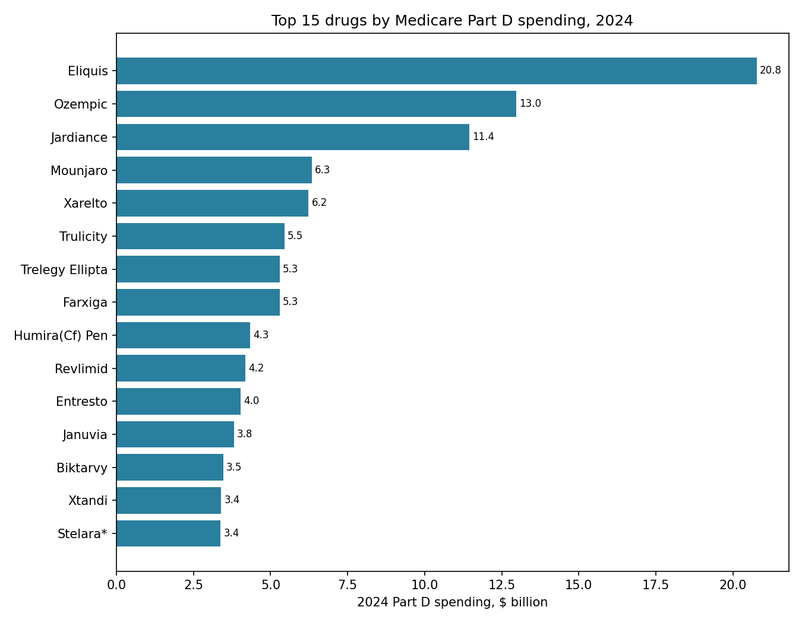
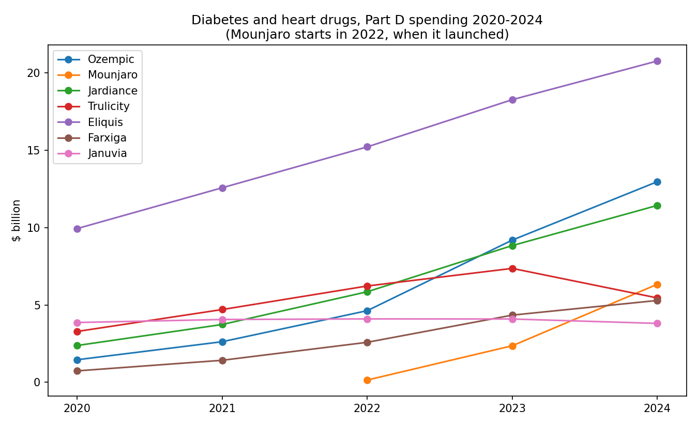
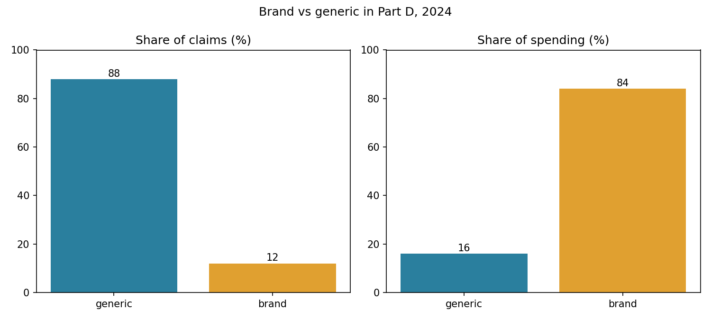
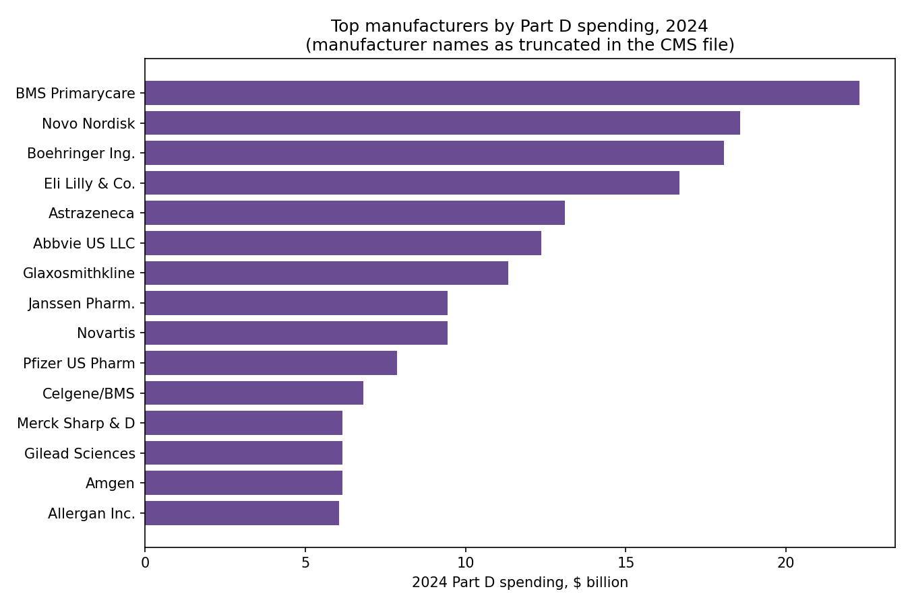

# Where the Medicare Part D money goes (2020-2024)

If you work in pharma, you want to know which products carry the market, which classes are growing, and who sells them. This project answers that with the public CMS "Medicare Part D Spending by Drug" data.

## Data
- CMS Medicare Part D Spending by Drug (data year 2024, released 2026): https://data.cms.gov/summary-statistics-on-use-and-payments/medicare-medicaid-spending-by-drug/medicare-part-d-spending-by-drug
- One row per brand (and one per brand and manufacturer): total spending, claims, beneficiaries and average cost per dosage unit for each year 2020 to 2024.
- File in `data/part_d_spending_by_drug_2024.csv`. Total 2024 spending in the file is $288.7 billion (2020: $194.1 billion).
- Medicare Part D covers retail prescriptions for people on Medicare in the US. It does not cover hospital-administered drugs, and spending is before manufacturer rebates (see limits).

## Method
SQLite for the questions (`src/analyze.py`, each result saved as `data/sql_*.csv`), pandas, matplotlib and plotly for the rest. The brand-level rows ("Overall") are used for drug rankings and the manufacturer rows for the company ranking.

## Findings
- Eliquis (apixaban) is the biggest drug at $20.8 billion, 7.2% of all Part D spending. Its spend doubled since 2020 ($9.9 billion).
- Diabetes and obesity drugs drive growth. Ozempic went from $1.5 billion in 2020 to $13.0 billion in 2024 (8.9 times). Jardiance rose 4.8 times to $11.4 billion and Farxiga 7.2 times to $5.3 billion. Mounjaro, launched in 2022, already reached $6.3 billion.
- By my class grouping (generic-name keywords, see `src/analyze.py`), GLP-1/GIP drugs went from $7.1 billion to $27.6 billion and SGLT2 drugs from $4.0 billion to $17.9 billion. DPP-4 drugs stayed flat around $6-7 billion.
- Insulin spend fell from $16.3 billion in 2023 to $8.1 billion in 2024 in this file. I did not dig into why, so I am not claiming a cause. A drop that size is worth checking against the CMS notes and insulin pricing news before quoting it.
- Generics are most of the prescriptions and little of the money: about 88% of claims but 16% of spending (rough split, see limits). A brand claim costs about $1,176 on average against $31 for a generic-type claim.
- Manufacturers: BMS Primarycare ($22.3 billion, mostly Eliquis), Novo Nordisk ($18.6 billion), Boehringer Ingelheim ($18.1 billion) and Eli Lilly ($16.7 billion) lead. Top 12 are in `data/sql_top_manufacturers_2024.csv`.
- Price per dosage unit: Erleada rose about 22% a year from 2020 to 2024 among drugs above $1 billion, Xtandi about 10%, most others 5-7%.






Interactive version: `dashboard.html` (needs internet for the plotting library).

## Limits
- Spending is gross, before rebates and discounts the manufacturers pay to plans. Net spending is much lower for many brands, so these are not company revenues.
- CMS gives no brand or generic flag. I treat a product as generic-type when its name equals the generic name or more than one manufacturer sells it. That misfiles some products (authorized generics, and for example Humira's second labeller), so the 88% and 16% are approximate.
- Part D only. Medicare Part B (clinic-administered drugs), Medicaid and commercial insurance are not here.
- US Medicare population, which skews older. It does not describe Saudi Arabia.
- Drug classes come from my own keyword list. Change it in the script if you disagree.

## Reproduce
```
pip install pandas numpy matplotlib plotly
python src/analyze.py
```

## Next steps
Add Part B spending, join with the Part D prescribers file to see which specialties write the high-cost drugs, and build the same views in Tableau Public from the CSVs in `data/`.

## Running it

The 5 MB source file and the SQLite database are not stored in this repo. Download "Medicare Part D Spending by Drug" from https://data.cms.gov/summary-statistics-on-use-and-payments/medicare-medicaid-spending-by-drug/medicare-part-d-spending-by-drug and save it as `data/part_d_spending_by_drug_2024.csv`, then run `src/analyze.py`. The result tables in `data/` are included.
